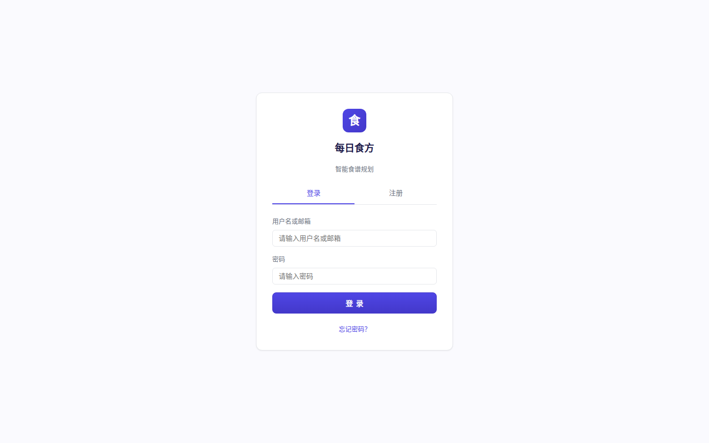
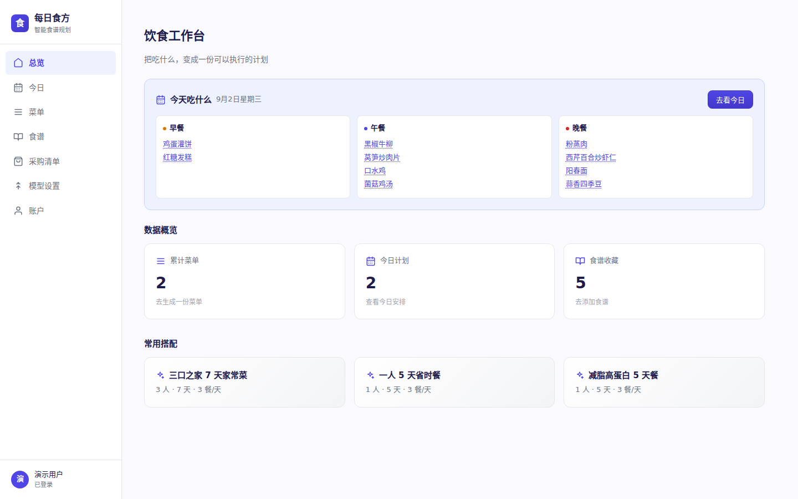
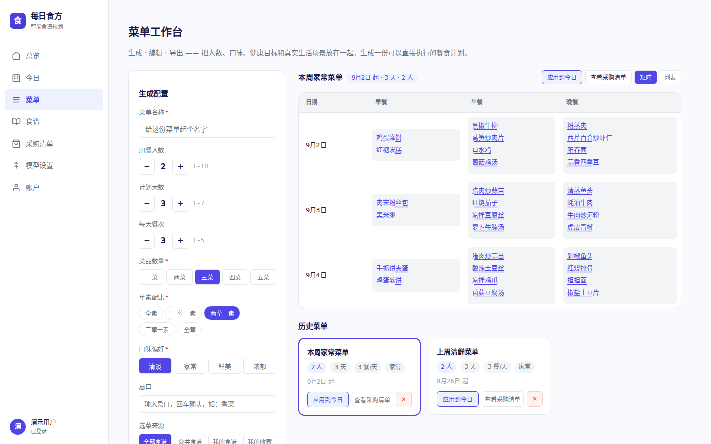
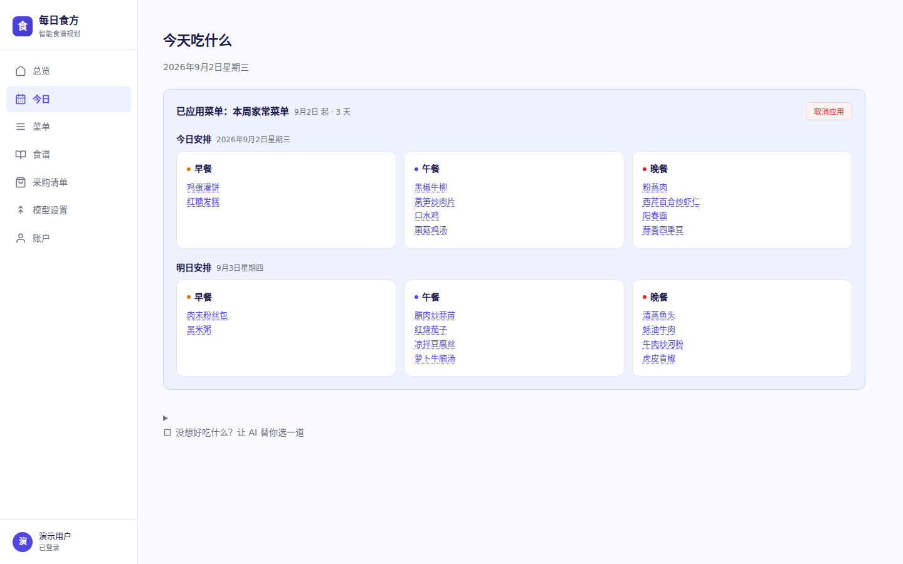
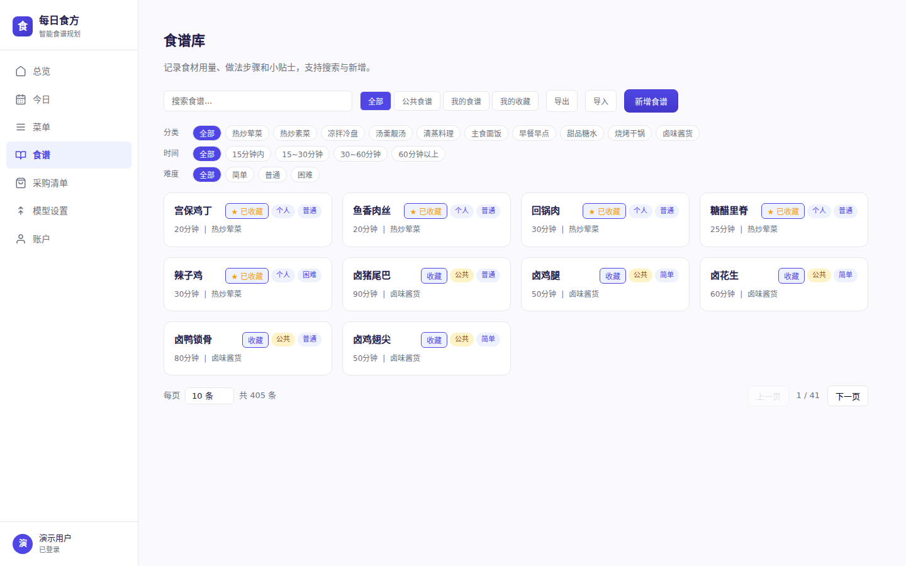
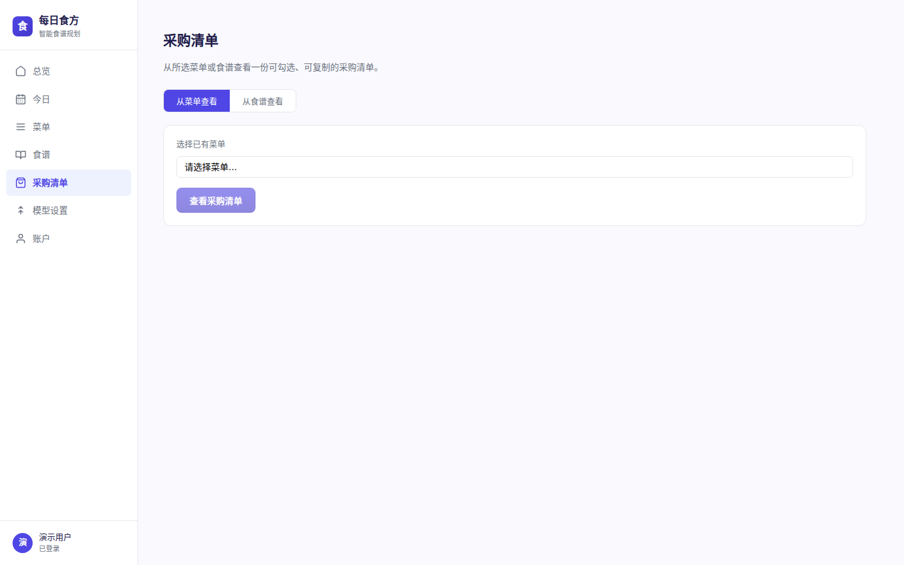
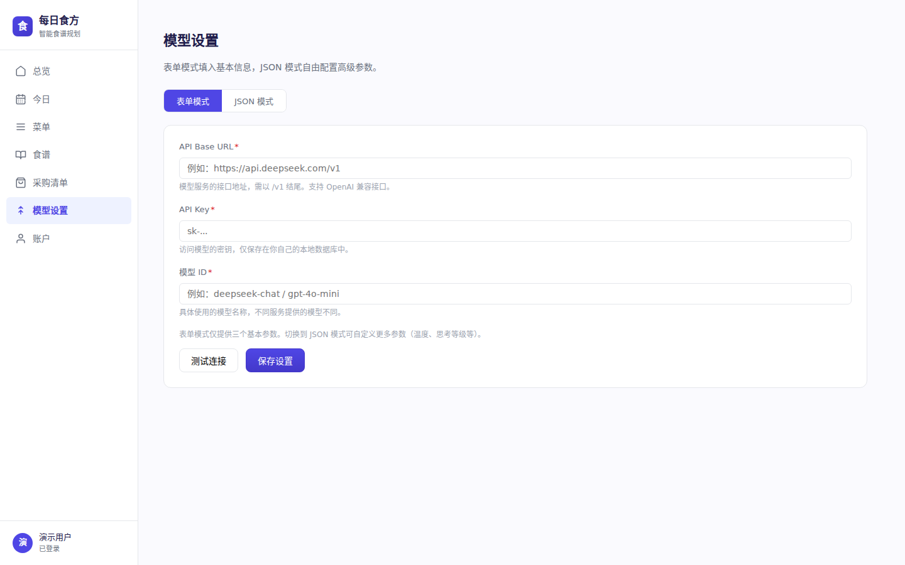
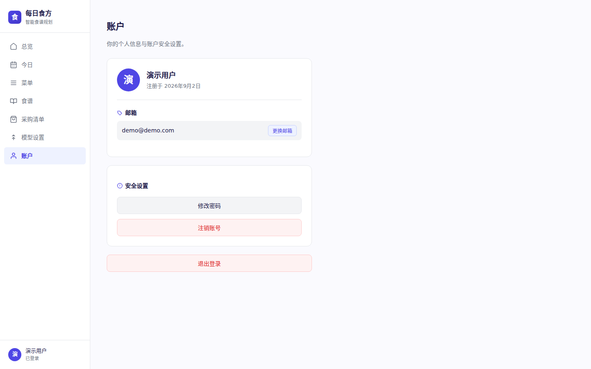

# 每日食方

每天都要面对「今天吃什么」。

每日食方把这个每天都会问的问题，变成一个表单：填上几个人、吃几天、忌口和口味偏好，它给出一份多天菜单；菜单里的食材顺带汇总成一张采购清单。剩下的交给厨房。

- **账号流程自给自足**：注册、找回密码、换绑邮箱、注销都走邮箱验证码，不依赖第三方登录
- **内置 400 道食谱**：不开大模型也能浏览、搜索、收藏，当食谱库用也够完整
- **模型自己选**：后端只调标准 OpenAI 兼容接口，在设置页填 Base URL 和 Key 即可，DeepSeek、自建网关都行

往下翻看界面，想自己跑起来直接去[快速开始](#快速开始)。

## 界面预览

> 截图来自本地开发环境（示例数据）。页面布局可能随后续迭代微调。

| 页面截图 | 功能说明 |
|----------|----------|
|  | 注册 / 登录 / 找回密码在一个页面走完。注册走邮箱验证码两步确认；SMTP 未配置时验证码会直接显示出来，本地体验不被卡住。 |
|  | 菜单 / 今日计划 / 食谱 / 采购清单的真实统计 + 今日三餐预览 + 常用搭配模板，点一下带参数跳去菜单页。 |
|  | 人数、天数、餐次、忌口、口味、荤素配比都在这一页配，AI 生成多天菜单，可切换矩阵 / 列表视图，历史菜单分页回看。 |
|  | 菜单固定到具体某一天后的样子，三餐安排和明日预览一目了然；临时想加菜，可让 AI 随机补一道。 |
|  | 10 个分类共 400 道内置菜，用量、步骤、小贴士齐全，支持搜索、分页与收藏。 |
|  | 菜单或食谱里的食材按类目汇总成一张清单，买一样勾一样。 |
|  | Base URL / API Key / 模型名在这里填，兼容任意 OpenAI 兼容服务；JSON 模式可传高级参数。 |
|  | 改资料、换邮箱、改密码、注销集中在一页，注销需要密码 + 验证码两步确认。 |

## 快速开始

本地开发环境即可跑通，不需要 Docker。依赖：Python 3.11+、Node.js 20+、MySQL 8.0+ 或 MariaDB 10.5+。

### 1. 建库

```bash
mysql -u root -p -e "CREATE DATABASE IF NOT EXISTS daily_menu CHARACTER SET utf8mb4 COLLATE utf8mb4_unicode_ci;"
```

数据库连接信息用环境变量覆盖（默认值见 `server/config.py`）：

| 变量 | 说明 | 默认值 |
|------|------|--------|
| `DM_DB_HOST` | 数据库地址 | 127.0.0.1 |
| `DM_DB_PORT` | 数据库端口 | 3306 |
| `DM_DB_USER` | 数据库用户 | root |
| `DM_DB_PASSWORD` | 数据库密码 | 空 |
| `DM_DB_NAME` | 数据库名 | daily_menu |

### 2. 起后端

```bash
cd server
python -m venv .venv && source .venv/bin/activate
pip install -r requirements.txt
uvicorn main:app --reload --port 8000   # 想换端口改这里，如 --port 8080
```

首次启动会自动建表；未设置 `DM_SECRET_KEY` 时会生成随机密钥并保存到 `server/.secret_key`。后端默认在 `http://localhost:8000`。

想让食谱页有内容，可再插入公共食谱（幂等，可重复执行）：

```bash
cd server && source .venv/bin/activate
python seed_public_recipes.py
```

### 3. 起前端

```bash
cd client
npm install
npm run dev    # http://localhost:5173；换端口：npm run dev -- --port 3000
```

前端会把 `/api` 代理到 `http://localhost:8000`（后端换了端口记得同步改 `client/vite.config.ts` 里的代理地址）。生产构建用 `npm run build && npm run preview`。

### 4. 走通一遍

1. 注册登录（验证码没配 SMTP 也会直接显示，见下方邮件配置）
2. 在「模型设置」填好模型（只接了公共食谱、没有模型 key 的话，跳过这步直接浏览食谱也能看完整界面）
3. 「菜单」里生成一份菜单 → 「今日」里应用 → 顺手看一眼「采购清单」

## 模型配置

所有 AI 功能都由后端统一代理调用，参数透传，只要求服务兼容 OpenAI 接口格式。

在「模型设置」页面填写：

- Base URL，例如 `https://api.deepseek.com`
- API Key
- 模型名，例如 `deepseek-chat`

表单模式够日常使用；JSON 模式可以自由传额外参数。API Key 只存在本地数据库，不会下发到前端。

## 邮件配置

找回密码、注册、换绑邮箱、注销都会触发验证码邮件。**未配置 SMTP 时验证码打印到后端控制台（开发模式前端也会直接显示）**，开发期不会被卡住。

邮件是 HTML + 纯文本双版本，HTML 模板是独立文件 `server/templates/email/verification_email.html`——改样式直接编辑它即可，无需动代码。

要发真实邮件，按三步走：

1. **取授权码**：登录 QQ / 163 网页邮箱 → 「设置 → 账户 / POP3-SMTP」→ 开启 SMTP 服务 → 短信验证后获得授权码（16 位左右）。企业 / 自有 SMTP 服务通常直接用真实密码。
2. **配环境变量**：

| 变量 | 说明 | 默认值 |
|------|------|--------|
| `DM_SMTP_HOST` | SMTP 服务器地址 | 空（未配置时控制台打印验证码） |
| `DM_SMTP_PORT` | SMTP 端口 | 587 |
| `DM_SMTP_USER` | SMTP 用户名 | 空 |
| `DM_SMTP_PASSWORD` | SMTP 密码（QQ/163 等用授权码） | 空 |
| `DM_SMTP_FROM` | 发件人地址 | 同 SMTP_USER |
| `DM_SMTP_TLS` | 是否启用 STARTTLS（587 端口） | True |
| `DM_SMTP_SSL` | SSL 模式：`auto` / `true` / `false`（auto 时 465、994 端口自动启用 SSL） | auto |

   常用邮箱参考：

| 邮箱 | SMTP 地址 | 端口 | 加密 |
|------|-----------|------|------|
| QQ 邮箱 | smtp.qq.com | 465 | SSL |
| 163 邮箱 | smtp.163.com | 465 / 994 | SSL |
| 其它支持 STARTTLS 的服务 | - | 587 | STARTTLS |

```bash
# QQ 邮箱（SSL 465，密码填授权码）
export DM_SMTP_HOST=smtp.qq.com
export DM_SMTP_PORT=465
export DM_SMTP_USER=you@qq.com
export DM_SMTP_PASSWORD=your-auth-code
export DM_SMTP_FROM=you@qq.com
export DM_SMTP_TLS=False
```

```bash
# 通用 STARTTLS（587，企业邮箱 / 自有服务）
export DM_SMTP_HOST=smtp.example.com
export DM_SMTP_PORT=587
export DM_SMTP_USER=you@example.com
export DM_SMTP_PASSWORD=your-password
export DM_SMTP_FROM=you@example.com
```

`DM_SMTP_SSL` 默认 `auto`：端口 465 / 994 自动走 SSL，其余端口走 STARTTLS（由 `DM_SMTP_TLS` 控制），一般不用手动设置。

3. **验证**：重启后端，任一处触发验证码。收到信即配置成功；失败会自动回退到控制台打印，方便排查。

## 技术栈

| 层面 | 技术 |
|------|------|
| 前端 | Vite 8 + React 19 + TypeScript（CSS 变量主题） |
| 后端 | Python FastAPI + MySQL（pymysql + DictCursor） |
| 认证 | JWT (HS256) + bcrypt 密码哈希 |
| LLM | 后端代理 OpenAI 兼容接口，参数透传 |

## 项目结构

```
├── client/                     # 前端（Vite + React + TS）
│   ├── src/
│   │   ├── api/                # 各模块 API 调用封装
│   │   ├── components/         # 通用组件（ingredients/menu/recipe/ui）
│   │   ├── context/            # 全局状态（AuthContext）
│   │   ├── hooks/              # 自定义 Hooks（useApi）
│   │   ├── layout/             # 布局（Shell 侧边栏）
│   │   ├── pages/              # 页面：登录/总览/今日/菜单/食谱/采购清单/模型设置/账户
│   │   ├── constants/          # 共享常量（食谱分类、餐次颜色等）
│   │   ├── types/              # TypeScript 类型定义
│   │   └── utils/              # 共享工具函数（日期格式化等）
│   └── vite.config.ts          # 开发代理 /api → localhost:8000
├── docs/                       # 文档素材（README 界面预览截图等）
└── server/                     # 后端（FastAPI）
    ├── routers/                # 路由：auth/account/menus/llm/today/ingredients/recipes/settings/stats
    ├── services/               # LLM 客户端 + Prompt 构建器 + 邮件服务
    ├── templates/              # 邮件等 HTML 模板（email/verification_email.html）
    ├── data/                   # 公共食谱数据（公开数据，不随 GPL 授权）
    ├── main.py                 # 应用入口
    ├── config.py               # 配置（环境变量）
    ├── db.py                   # MySQL 建表与连接
    ├── seed_public_recipes.py  # 公共食谱种子脚本（幂等，可重复运行）
    └── requirements.txt        # Python 依赖
```

## 部署提醒

自用或小范围内部使用没有问题，上线公网前注意几点：

- API Key 只存在服务器数据库，不暴露给前端
- 生产环境务必设置 `DM_SECRET_KEY`，并套 HTTPS（反代 + TLS 终止）
- 数据库、SMTP 等敏感信息都用环境变量注入，不要写进代码或提交进仓库
- 本服务没有内置后台管理 / 用户隔离之外的审计能力，别把它当多租户平台用

## License

**代码与文档**（前端、后端、服务端邮件模板等）以 [GNU GPL-3.0](LICENSE) 授权。

要点：你可以自由使用、修改和分发本软件（包括商用），但分发时需保留版权声明、提供源代码并保持 GPL-3.0 授权。完整条款见 [LICENSE](LICENSE)。

**公共食谱数据**（`server/data/public_recipes.py`，400 道家常菜信息）为公开整理数据，不属于 GPL-3.0 授权范围，可独立使用，不随代码的许可证约束。
